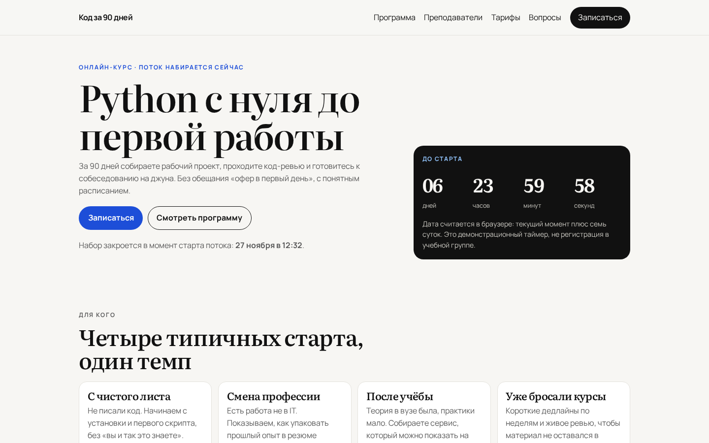
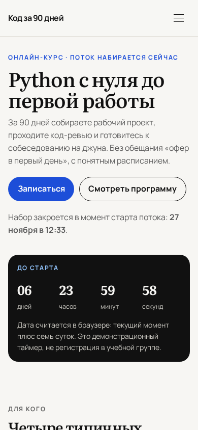

# Код за 90 дней — лендинг курса Python

Продающая страница вымышленной школы «Код за 90 дней». Она закрывает запись на поток «Python с нуля до первой работы»: показывает срок старта, программу, тарифы и принимает заявку без оплаты и без сервера.

Демо: https://swattt555333.github.io/online-course/

## Скриншоты





## Что реализовано

- Герой с оффером, дедлайном набора и кнопкой «Записаться», которая ведёт к форме.
- Таймер обратного отсчёта. В `js/main.js` конец отсчёта равен текущему моменту плюс семь суток. На экране дни, часы, минуты и секунды, рядом — календарная дата старта на русском.
- Четыре карточки «для кого курс».
- Аккордеон программы из шести модулей: открыт один пункт, у кнопки меняется `aria-expanded`.
- Три преподавателя с фотографиями Unsplash, у каждой заданы `width`, `height` и `loading="lazy"`.
- Счётчики выпускников. Числа доезжают от нуля, когда блок попадает в зону `IntersectionObserver`.
- Слайдер из четырёх отзывов: кнопки, точки, стрелки клавиатуры, когда карусель в фокусе, и свайп пальцем на телефоне.
- Три тарифа. Средний, «С наставником», выделен плашкой «Популярный».
- Аккордеон FAQ из пяти вопросов.
- Форма заявки: имя, телефон с маской `+7 (___) ___-__-__`, выбор тарифа. Пустые и кривые поля подсвечиваются. После успеха открывается модальное окно «Заявка отправлена». Данные никуда не уходят.
- Бургер на ширине меньше 1024px, закреплённая шапка, плавный переход к якорям, появление блоков при прокрутке, hover у кнопок за счёт смены фона и рамки.

## Стек

HTML5, CSS3 и ванильный JavaScript. Шрифты Literata и Manrope подключены с Google Fonts с `display=swap`. Сборщика и npm внутри этой папки нет.

## Структура

```text
online-course/
├── index.html                 страница курса
├── css/style.css              сетка, таймер, аккордеон, тарифы, форма
├── js/main.js                 меню, таймер, счётчики, слайдер, маска, валидация
├── img/favicon.svg            значок вкладки
├── img/screenshot-desktop.png первый экран 1440×900
├── img/screenshot-mobile.png  первый экран 390×844
└── README.md
```

## Как запустить локально

1. Скачайте папку `online-course`.
2. Откройте `index.html` двойным щелчком. Стили и скрипт подключены относительными путями, локальный сервер не нужен.
3. Для фотографий преподавателей нужен интернет: они грузятся с `images.unsplash.com`.

## Автор

InterPanic
